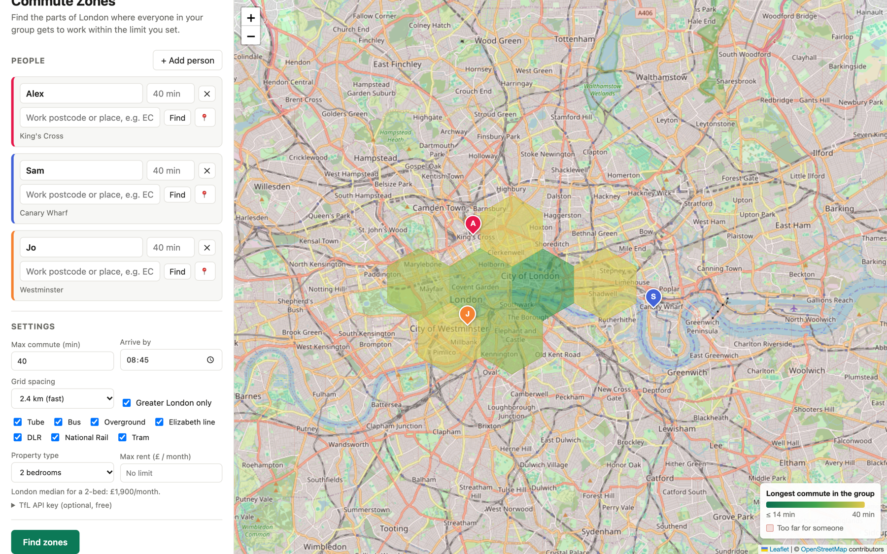

# Commute Zones

Commute Zones finds the areas of London where every member of a group can reach their workplace within a set commute time. It uses live journey times from Transport for London and shows median rents for each area.

**Live site:** https://pgorenkin21.github.io/commute-zones/



## Overview

When several people share a home, each person's commute has to be considered. Commute Zones lays a hexagonal grid over London. It asks the TfL Journey Planner for the journey time from each point to each person's workplace, then marks the areas where every journey is within that person's limit.

### Features

- **Multiple commuters.** Each person enters a workplace by postcode or address, or by selecting a point on the map. Each person can also have their own maximum commute time.
- **TfL journey times.** Times are door to door, including walking, for a typical weekday (Tuesday to Thursday) arriving by a chosen time. You can choose which modes count: Underground, bus, Overground, Elizabeth line, DLR, National Rail and tram.
- **Colour-coded map.** Areas are shaded by the longest commute in the group. Areas outside the limit for any person are marked separately.
- **Neighbourhood list.** Areas that work are grouped by ward and borough. They can be sorted by the longest commute or by rent.
- **Rental data.** Median monthly rents by postcode district are included, from a room in a shared house up to four or more bedrooms. If a district has too few recorded rents, the borough figure is used. You can set a rent budget to exclude areas that cost more.
- **Efficient searching.** Points that are clearly out of range are skipped before any request is made. The most promising areas are checked first. Results are cached in the browser, so repeat searches are fast.

## Usage

1. Open the [live site](https://pgorenkin21.github.io/commute-zones/).
2. Add each person and enter their workplace.
3. Set the maximum commute time, the time you need to arrive by, and the transport modes to include.
4. Select **Find zones**.

### TfL API key

The app works without an API key, but TfL limits anonymous requests, so a search can take several minutes. A free key from the [TfL API Portal](https://api-portal.tfl.gov.uk/) makes searches about eight times faster. Enter it under **TfL API key** in the settings. It is stored only in your own browser.

## Running locally

The project is a static site with no dependencies and no build step. Serve the folder with any static file server:

```bash
git clone https://github.com/pgorenkin21/commute-zones.git
cd commute-zones
python3 -m http.server 8765
```

Then open http://localhost:8765. On macOS, you can also run `start.command`.

## Project structure

| File | Description |
|------|-------------|
| `index.html` | Page layout and controls |
| `app.js` | Application logic: geocoding, grid generation, journey lookups, map rendering |
| `rents.js` | Median rent data by postcode district and borough |
| `styles.css` | Styles |
| `start.command` | macOS launcher that starts a local server and opens the browser |

## Data sources

| Data | Source |
|------|--------|
| Journey times | [TfL Unified API](https://api.tfl.gov.uk/) (Journey Planner) |
| Geocoding | [postcodes.io](https://postcodes.io/) and [Nominatim](https://nominatim.openstreetmap.org/) |
| Map tiles | [OpenStreetMap](https://www.openstreetmap.org/), rendered with [Leaflet](https://leafletjs.com/) |
| Rents | Office for National Statistics, *Private Rental Market in London*, April 2025 to March 2026 |

## Attribution

Powered by TfL Open Data. Contains OS data © Crown copyright and database rights. Map data © OpenStreetMap contributors. Rental data © Office for National Statistics, licensed under the Open Government Licence v3.0.
